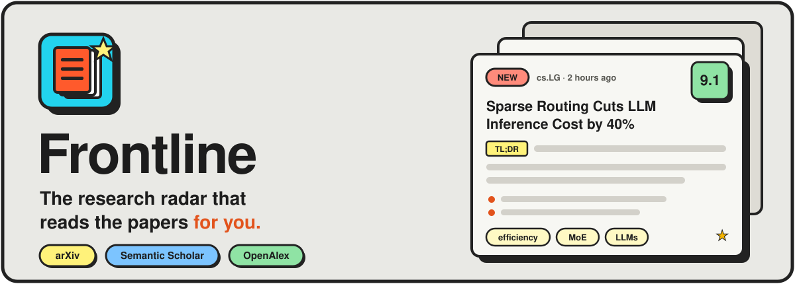
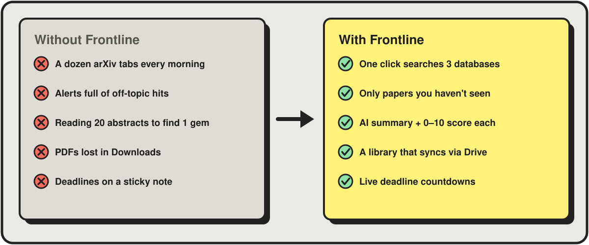
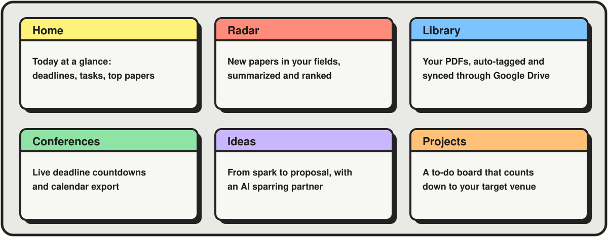
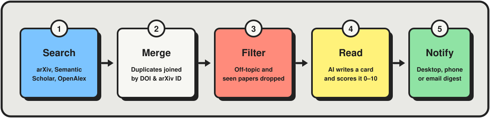

<p align="center">
  
</p>

<p align="center">
  
  
  
  
</p>

<p align="center">
  <b>Stop drowning in arXiv.</b> Frontline finds the new papers in your field, reads them,<br>
  and tells you which ones are worth your time, all from one desktop app.
</p>

---

## Why Frontline?

Keeping up with research is a part-time job. Hundreds of papers land every week, alerts are noisy, and the one paper that matters is buried on page three. Frontline does the digging so you can do the thinking.

<p align="center">
  
</p>

- ⚡ **One click, three databases.** Press **Sweep now** and Frontline searches arXiv, Semantic Scholar and OpenAlex at the same time.
- 🧹 **No repeats, no noise.** The same paper from different sources is merged into one, papers you've already seen are skipped, and off-topic results are dropped.
- 🧠 **Read 20 papers in 2 minutes.** AI writes a short briefing card for each paper (TL;DR, key points, method, results, limitations) and scores how relevant it is **to you**, from 0 to 10.
- 🔬 **Follow the labs you care about.** Add a professor by name, and you'll see every paper their lab puts out.
- 📚 **Everything else in one place.** A paper library, a conference deadline tracker, an ideas notebook and a project board, all connected.
- 🔒 **Your data stays yours.** Everything is stored on your computer. Your PDFs are plain files in a folder you choose.

### How it compares

| | **Frontline** | Google Scholar alerts | arXiv email digests | Reference managers |
|---|:---:|:---:|:---:|:---:|
| Finds new papers in your field | ✅ | ✅ | ✅ | ❌ |
| Searches several databases at once | ✅ | ➖ | ❌ | ❌ |
| AI summary for every paper | ✅ | ❌ | ❌ | ❌ |
| Ranks papers by relevance to *you* | ✅ | ❌ | ❌ | ❌ |
| Follow a lab, not just an author profile | ✅ | ➖ | ❌ | ❌ |
| Chat with a paper's full PDF | ✅ | ❌ | ❌ | ➖ |
| Conference deadlines + calendar export | ✅ | ❌ | ❌ | ❌ |
| Ideas → proposals → projects | ✅ | ❌ | ❌ | ❌ |

---

## A morning with Frontline

1. **☕ Open the app.** Your morning sweep has already run (if you scheduled it), and a notification tells you what it found.
2. **👀 Skim the cards.** The best papers are at the top with a green score. Drag the relevance slider to hide the rest.
3. **📖 Go deep on the one that matters.** Click **Deep dive** and AI reads the *full PDF*, then gives you the method, the real numbers and a read/skip verdict. Got a question? **Ask the paper.**
4. **💾 Keep it.** **Save to library** puts the PDF into your Google Drive folder, already tagged and summarized.
5. **💡 Act on it.** Turn the spark into an idea, the idea into a proposal, and the proposal into a project with tasks and a target conference.

---

## Everything in one window

<p align="center">
  
</p>

| Section | What it does for you |
|---|---|
| 🏠 **Home** | Today at a glance: next deadlines, tasks due this week, the best new papers, your reading queue and recent ideas. |
| 📡 **Radar** | Your feed of fresh papers, with AI summaries, scores and a sweep digest. |
| 📚 **Library** | Your PDFs in a folder you choose (Google Drive, Dropbox, OneDrive), tagged by your interests automatically. |
| 🗓️ **Conferences** | Live countdowns to the deadlines you care about, from a catalog of ML, vision, NLP and robotics venues. |
| 💡 **Ideas** | Capture ideas, grow them into proposals and roadmaps, and pressure-test them with AI. |
| ✅ **Projects** | A to-do board and backlog for each project, counting down to its target venue. |

---

## How it works

<p align="center">
  
</p>

No AI key? Frontline still works. Cards fall back to extracts from the abstract and keyword-based scores.

---

## Get started in 2 minutes

You need Python 3.10+ and, for the AI features, an [Anthropic](https://console.anthropic.com/) (Claude) or [OpenAI](https://platform.openai.com/api-keys) API key.

### 🍎 macOS

```zsh
git clone https://github.com/SakethGG/Frontline.git ~/Projects/Frontline
cd ~/Projects/Frontline
./install-desktop.sh        # one time: sets up .venv and creates ~/Applications/Frontline.app
```

Put your `ANTHROPIC_API_KEY` (or `OPENAI_API_KEY`) in `.env`, then open **Frontline** from Spotlight (`Cmd+Space`, type "Frontline"). To keep it in the Dock, right-click its icon while it's running and choose **Options → Keep in Dock**.

### 🪟 Windows

```powershell
git clone https://github.com/SakethGG/Frontline.git
cd Frontline
.\install-desktop.ps1       # one time: sets up .venv and adds Desktop + Start-menu icons
```

Put your API key in `.env`, then double-click **Frontline** on your Desktop.

### 🌐 Linux, or any browser

```zsh
python3 -m venv .venv
.venv/bin/pip install -r requirements.txt
cp .env.example .env        # then add your API key
.venv/bin/python -m uvicorn frontline.app:app --port 8000
```

Open http://localhost:8000. Press `Ctrl+C` to stop.

### Your first sweep

1. Go to **Radar** and add a topic (for example, *"efficient LLM inference"*).
2. Optionally, click **+ Researcher** to follow a lab.
3. Press **Sweep now**. A minute later you'll have your first stack of briefing cards.

---

## Features in detail

<details>
<summary><b>📡 Radar: papers, summaries and researchers</b></summary>

- **One-click sweep** across three free scholarly APIs. Results are merged by arXiv ID, DOI or title, and papers you've already seen are skipped, so each sweep shows only new work.
- **Topics with subtopics.** It starts empty: add any field from the app. Each topic has search phrases, optional arXiv categories and a look-back window.
- **AI briefing cards:** TL;DR, 3–5 key points, problem / method / results / why it matters / limitations, paper type, and a relevance score with a one-line reason. Use the min-relevance slider to hide noise.
- **Sweep digest:** headline must-reads, themes and "worth watching" across everything found.
- **Deep dive:** AI reads the **full PDF** and writes a dense breakdown covering method, setup, the actual numbers, limitations, ideas worth stealing and a read/skip verdict.
- **Ask the paper:** a chat about any paper, grounded in its PDF. The PDF is prompt-cached, so follow-up questions cost less.
- **Researchers you follow.** Click **+ Researcher**, type a professor's name, and pick the right person from the candidates (institution, h-index and research areas tell namesakes apart). Their feed shows every paper they co-author, which in practice is their lab's output. It draws on OpenAlex (by author ID, plus same-name papers at their institution, since author databases often split one person into several profiles) and on arXiv (by name, within the categories they publish in) for the freshest preprints. Following someone backfills the last 6 months right away. AI scores each paper against the lab's research areas, so a paper wrongly attributed to a namesake scores low and is hidden.
- **Reading workflow:** star papers, track unread, filter by topic, subtopic or sweep, full-text search, one-click BibTeX, code-link detection, and Markdown export of any view.
- **Notifications:** desktop notification when a sweep finishes, optional phone push via [ntfy.sh](https://ntfy.sh) (no account needed), and an optional email digest.
- **Scheduled sweeps** (`FRONTLINE_AUTO_SWEEP_HOURS`), so new papers arrive without you pressing anything.

**Navigating:** topic pills → **New / All / Starred** tabs → optional subtopic chip → click any card to open the **reader panel**. Its ‹ › buttons step through papers without closing it. Opening a paper marks it read, so **New** works like an inbox you can clear.

</details>

<details>
<summary><b>📚 Library</b></summary>

You pick a folder, ideally inside **Google Drive for desktop**, Dropbox or OneDrive, so the library syncs across devices. Frontline keeps plain PDF files there:

- Sub-folders are **collections**.
- Files you drop into the folder from anywhere show up on the next scan. Scans run at startup and when you open the Library.
- Moving or renaming a file keeps its notes, because files are matched by content.

Every PDF is identified from its arXiv ID or DOI when it has one, so you get the exact title, authors and abstract. It's then tagged against **your interests** and scored for fit. By default your interests are your Radar topics and subtopics, and you can edit them. With an AI key, tagging is one short call per new paper; without one, it uses keyword matching.

- **Filtering:** by interest, collection or reading status (To read / Reading / Read). Star papers and sort by relevance to you.
- **Paper drawer:** take notes, edit tags, move a paper between collections, copy its BibTeX, and run **Deep dive** or **Ask** on your local PDF.
- **Adding papers:** drag and drop, or **+ Add PDFs**. On any Radar paper, **⤓ Save to library** downloads its PDF into the folder and carries over its AI card.
- **Removing papers:** a removed PDF moves to a hidden `.frontline-trash` folder inside the library, so nothing is lost.

**Google Drive tip:** with Drive for desktop set to *stream* files, Frontline reads each new PDF once to index it, and Drive then downloads it. To keep a large library available offline, mark the folder *Available offline*.

</details>

<details>
<summary><b>🗓️ Conferences & workshops</b></summary>

- **Catalog:** browse the community-maintained [huggingface/ai-deadlines](https://github.com/huggingface/ai-deadlines) catalog. It covers ML, vision, NLP, robotics and more, with every deadline converted from AoE/PST/UTC into your local time.
- **Focus areas:** pick yours to get open deadlines suggested.
- **Tracking:** tracked venues stay up to date. When the catalog announces a series' next edition, it's added for you.
- **Manual entries:** add workshops, journals or anything missing by hand. If you edit a catalog venue's dates, later updates leave it alone.
- **Calendar export:** **📅 Export calendar** downloads an `.ics` file with every deadline (reminders a week and a day before), the conference dates and your dated tasks. Import it into Google Calendar, Outlook or Apple Calendar.

</details>

<details>
<summary><b>💡 Ideas</b></summary>

- **Capture:** type an idea and press Enter. Proposals and roadmaps start from a template.
- **Develop:** write Markdown notes (they save as you type), add tags and a milestone checklist, link the papers an idea builds on, and move ideas through **Spark → Exploring → Developing → Active → Parked** on a drag-and-drop board.
- **AI assistant** (API key needed):
  - **Pressure-test** gives strengths, weak spots, a novelty check against the linked papers, and next steps.
  - **Brainstorm** suggests six directions.
  - **Draft proposal** writes a full proposal outline.
  - **Plan milestones** adds a realistic roadmap.
- **🚀 Start a project:** turns an idea into a project. Its open milestones become tasks: the first goes on the To-do board, the rest go to Future.

</details>

<details>
<summary><b>✅ Projects</b></summary>

- **To-do board:** To do / In progress / Done, with drag and drop, due dates (overdue ones are flagged) and priorities.
- **Future tab:** for things you'll do later, so the board stays focused.
- **Target venue:** a project can point at a tracked conference, and its header counts down to the next deadline.
- **Inbox:** collects tasks with no project. **All tasks** shows everything.

</details>

<details>
<summary><b>⌨️ Keyboard shortcuts</b></summary>

| Keys | Action |
|---|---|
| `h` `r` `l` `c` `i` `p` | Jump to Home / Radar / Library / Conferences / Ideas / Projects |
| `n` | New idea or task |
| `/` | Search the current section |
| `?` | Show all shortcuts |
| `j` / `k` | Next / previous paper (Radar) |
| `Enter` / `Esc` | Open / close a paper |
| `s` / `u` | Star / toggle read |
| `d` | Deep dive |
| `1` `2` `3` | Switch tabs |
| `Shift+S` | Sweep now |

</details>

---

## Configuration

All settings live in `.env` (copy it from `.env.example`). Only an API key is needed to get going.

<details>
<summary><b>All settings</b></summary>

| Variable | What it does |
|---|---|
| `ANTHROPIC_API_KEY` | Enables Claude summaries, deep dives, Q&A and digests |
| `FRONTLINE_MODEL` | Claude model (default `claude-opus-5-5`) |
| `OPENAI_API_KEY` | Use OpenAI instead of Claude for the same features |
| `OPENAI_MODEL` | OpenAI model (default `gpt-5-mini`) |
| `FRONTLINE_LLM` | `claude`, `openai` or `auto` (default). `auto` uses OpenAI only when `OPENAI_API_KEY` is set and `ANTHROPIC_API_KEY` isn't |
| `FRONTLINE_SUMMARY_EFFORT` | Effort for card summaries (default `low`, which keeps sweeps fast and cheap) |
| `FRONTLINE_DEEP_DIVE_EFFORT` | Effort for deep dives (default `medium`) |
| `FRONTLINE_MAX_PAPERS_PER_TOPIC` | Cap on new papers summarized per topic per sweep (default 40) |
| `FRONTLINE_CONCURRENCY` | How many papers are summarized at once (default 4) |
| `FRONTLINE_RESEARCHER_LOOKBACK_DAYS` | How far back a followed researcher's feed goes (default 180) |
| `FRONTLINE_MAX_PAPERS_PER_RESEARCHER` | Cap on new papers summarized per researcher per sweep (default 60) |
| `FRONTLINE_AUTO_SWEEP_HOURS` | e.g. `12` runs a sweep twice a day while the app is open |
| `NTFY_TOPIC` | Push notifications. Install the ntfy app, subscribe to a hard-to-guess topic name, and put that name here |
| `NTFY_SERVER` | Your own ntfy server, if you don't use `https://ntfy.sh` |
| `SMTP_*`, `DIGEST_TO` | Email digest (for Gmail, use an app password with `smtp.gmail.com:587`) |
| `FRONTLINE_LIBRARY_DIR` | Default library folder (picking one in the app overrides it). E.g. `G:\My Drive\Research Papers` on Windows, or `~/Library/CloudStorage/GoogleDrive-you@gmail.com/My Drive/Research Papers` on a Mac |
| `SEMANTIC_SCHOLAR_API_KEY`, `OPENALEX_MAILTO` | Optional. Raise API rate limits |
| `PUBLIC_URL` | Base URL used for links in notifications (default `http://localhost:8000`). The desktop app sets it for you |
| `FRONTLINE_DB` | Where the SQLite database lives (default `data/frontline.db`) |

</details>

**💸 What does it cost?** Each new paper costs one short AI call (at low effort with Claude). That covers Radar papers and new PDFs in your library. If your library folder already holds hundreds of PDFs, the first scan tags each one once. Deep dives, Q&A and the idea assistant only run when you click them.

<details>
<summary><b>Desktop app notes</b></summary>

- The app opens in its own window, with no browser tab or terminal; the backend runs inside it. Only one window can be open at a time. Logs go to `data/frontline.log`.
- **macOS:** the first time, macOS may ask you to allow notifications from **Script Editor**, which is what sends them. The app is a small launcher that points at this folder, so if you move the project or recreate `.venv`, run `./install-desktop.sh` again. To uninstall, delete `~/Applications/Frontline.app`; your papers and settings stay in `data/`. Don't run the `.ps1` scripts on a Mac: they're for Windows.
- **Windows:** if you'd rather use a browser, `.\run.ps1` serves the app at http://localhost:8000.
- The app serves itself on port 8000 when it's free, and on a random port otherwise. Links in ntfy and email notifications only open the app when it's on 8000, so don't leave a separate `uvicorn` server running on that port.
- In browser mode, native desktop notifications aren't available. Browser, ntfy and email notifications all work.

</details>

---

## Under the hood

<details>
<summary><b>Project layout</b></summary>

| File | Role |
|---|---|
| `frontline/sources.py` | Paper fetchers (topic keyword search and per-author) and de-duplication |
| `frontline/researchers.py` | Researcher name search, profiles, arXiv category learning |
| `frontline/summarizer.py` | AI prompts (cards, deep dive, Q&A, digest) plus the no-key fallback |
| `frontline/sweep.py` | Orchestration, progress state, scheduler |
| `frontline/notify.py` | Desktop notifications (Windows/macOS), ntfy and email |
| `frontline/library.py` | Paper library: folder scanning, PDF metadata, interest tagging, file actions |
| `frontline/conferences.py` | Conference catalog, tracked venues, time zones, calendar export |
| `frontline/planner.py` | Ideas, idea assistant, projects and tasks |
| `frontline/db.py` | SQLite storage |
| `frontline/app.py` | FastAPI routes |
| `frontline/desktop.py` | Desktop window (pywebview), Windows shortcuts and macOS `.app` installer |
| `static/` | The single-page UI (no build step): `app.js` (shared helpers + Radar), `home.js`, `library.js`, `conferences.js`, `ideas.js`, `projects.js` |

</details>

## License

[MIT](LICENSE). Use it, fork it, make it yours.
